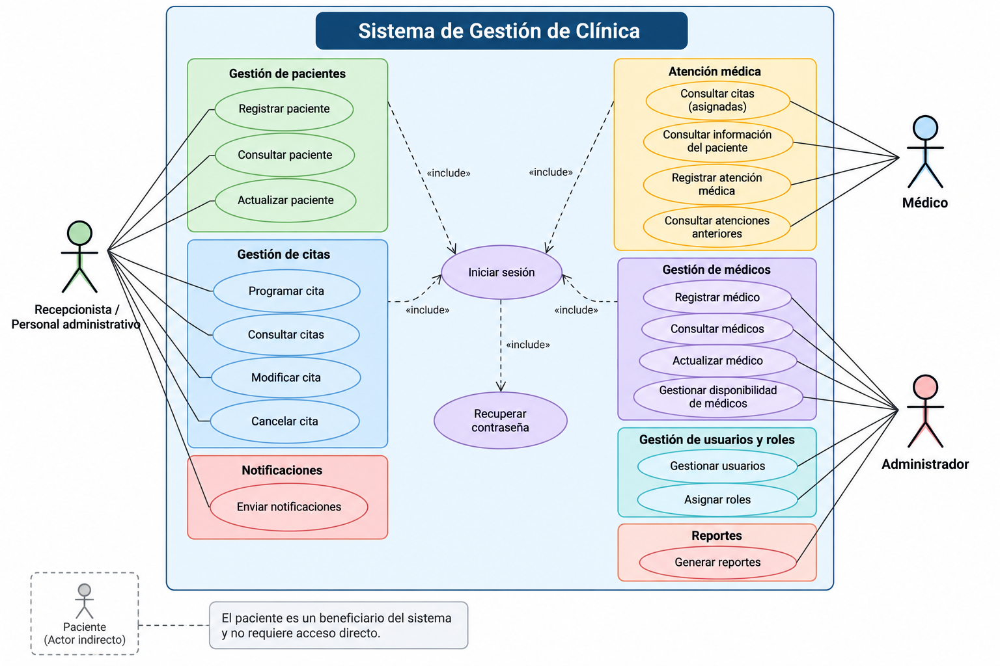
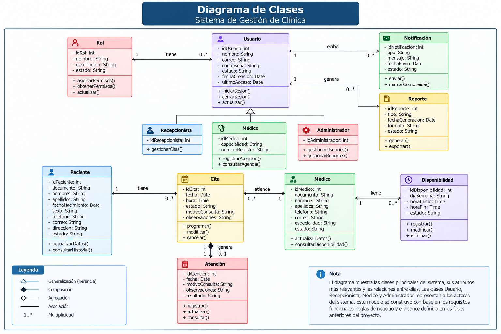
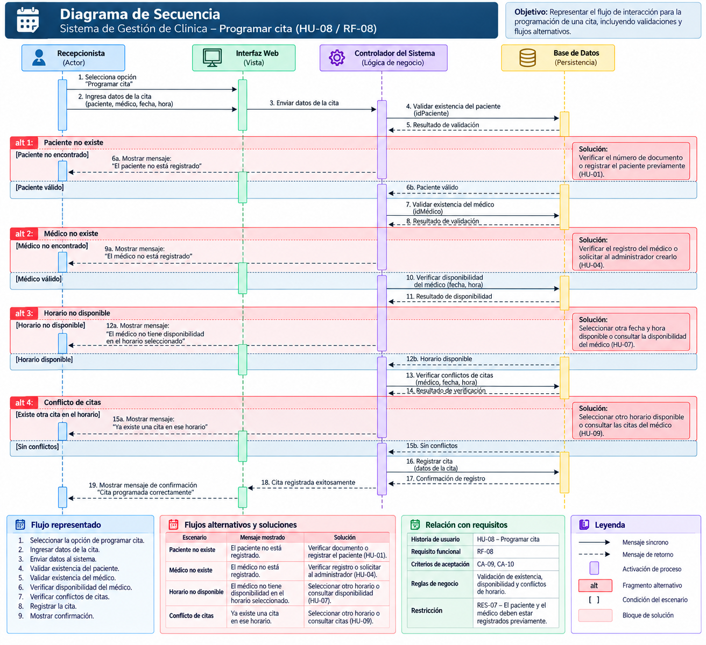
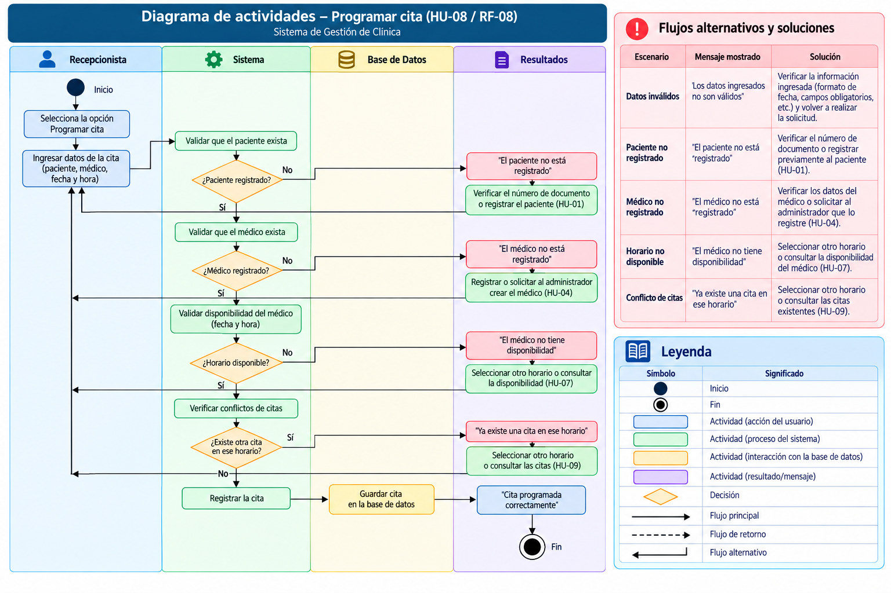
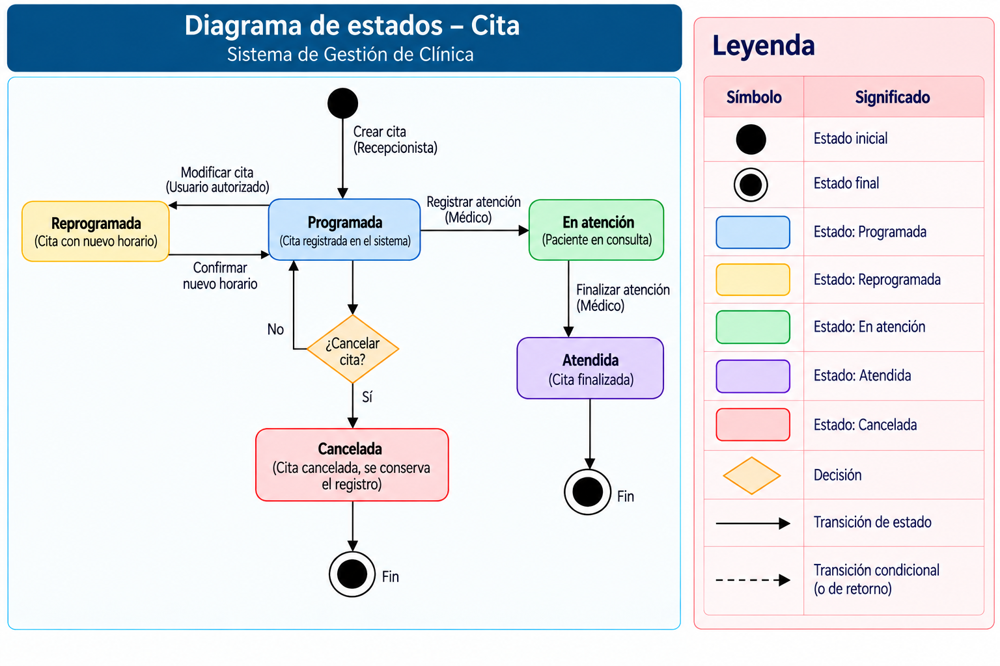

# Fase 3 - Modelado UML

## Sistema de Gestión de Clínica

Esta documentación corresponde al modelado UML del Sistema de Gestión de Clínica. El contenido y los diagramas se mantienen de acuerdo con el documento original de la Fase 3.

## Diagramas

### 1. Diagrama de casos de uso

Representa la interacción entre el Recepcionista o Personal administrativo, el Médico y el Administrador. El Paciente aparece como beneficiario y actor indirecto, sin acceso directo al sistema.

### 2. Diagrama de clases

Representa las clases principales del sistema, sus atributos, operaciones y relaciones: Usuario, Rol, Paciente, Médico, Administrador, Recepcionista, Cita, Atención, Disponibilidad, Notificación y Reporte.

### 3. Diagrama de secuencia

Describe el proceso de programación de una cita, incluyendo la validación del paciente, el médico, la disponibilidad, los conflictos de horario y los flujos alternativos.

### 4. Diagrama de actividades

Representa el flujo principal y los flujos alternativos para programar una cita, incluyendo las validaciones de datos, paciente, médico, disponibilidad y conflictos de citas.

### 5. Diagrama de estados

Representa el ciclo de vida de una cita mediante los estados Programada, Reprogramada, En atención, Atendida y Cancelada.

## Trazabilidad

| Diagrama | Relación documentada |
|---|---|
| Casos de uso | Historias de usuario y requisitos funcionales del sistema |
| Clases | Entidades, actores, relaciones y reglas de negocio |
| Secuencia | HU-08 / RF-08 - Programar cita |
| Actividades | HU-08 / RF-08 - Programar cita |
| Estados | Programación, modificación, atención y cancelación de citas |

## Fuentes editables

El documento Word contiene las imágenes finales, pero no incluye archivos fuente PlantUML o Draw.io editables. Para cumplir completamente esta observación, deben agregarse los archivos originales utilizados para crear los diagramas, si se encuentran disponibles.
